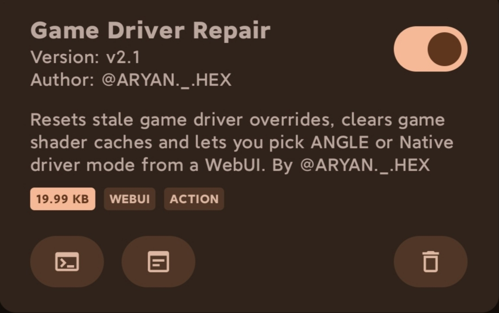
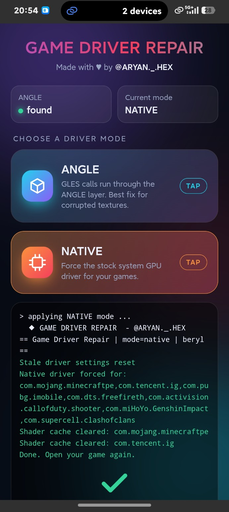
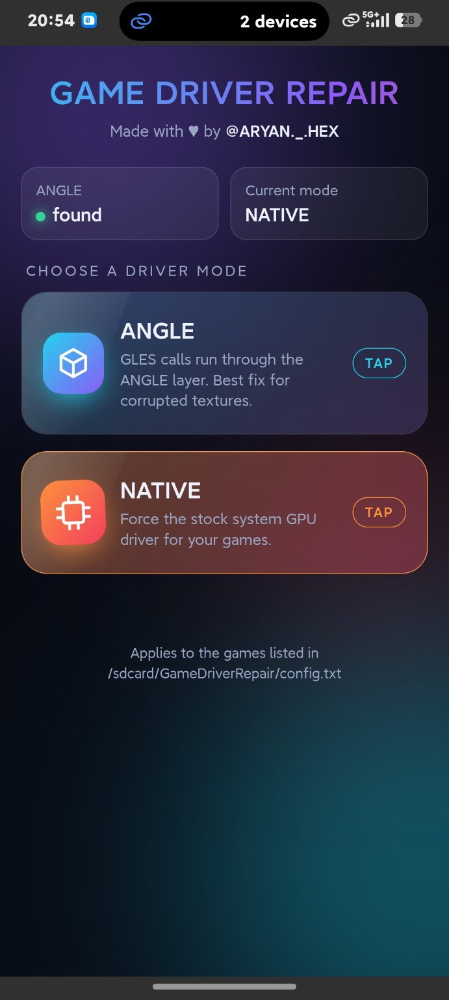

# GAME GPU REPAIR

**A lightweight Android root module for switching per-game graphics driver modes.**

Made with ♥ by **@ARYAN._.HEX**

**ANGLE · Native · Shader-cache cleanup · KSU Next WebUI**

---

## Overview

Game GPU Repair helps reset stale Android game-driver overrides and lets you choose **ANGLE** or **Native** mode for a configured list of games. Its KSU Next WebUI provides two mode buttons and displays the command output.

This v2.1 package keeps the supplied module's functionality and uses the requested v2.1 version label. Its version code remains **5**. The original uploaded ZIP is preserved unchanged in `original-upload/`.

The module is intended as a troubleshooting utility for graphics issues such as corrupted textures or rendering glitches. Results depend on the device, Android build, GPU driver stack and game; it does not guarantee higher FPS or fix every graphics problem.

## Screenshots

### Module card

### Native mode and execution log

### ANGLE and Native controls

## Features

- **ANGLE mode:** selects ANGLE for configured game packages when ANGLE is detected on the ROM.
- **Native mode:** selects the stock system GPU driver for configured game packages.
- **Stale override reset:** removes a set of global game-driver and ANGLE override settings before applying the selected mode.
- **Shader-cache cleanup:** optionally removes matching shader-cache entries for configured games.
- **Game process restart:** force-stops configured games after applying the selected mode.
- **KSU Next WebUI:** one-tap ANGLE and Native actions, ANGLE availability indicator, current-mode display and execution output.
- **Editable game list:** configure package names through the generated config file.

## Installation

1. Download `Game_GPU_Repair_by_ARYAN_v2.1.zip` from the GitHub **Releases** page.
2. Open **KernelSU Next** and go to its Modules section.
3. Choose **Install from storage** (wording may vary by manager version) and select the downloaded ZIP.
4. Complete installation and reboot if the manager requests it.
5. Open the installed module's **WebUI** from KSU Next.
6. Tap **ANGLE** or **NATIVE** to apply that mode to the configured games.

> The WebUI calls the `ksu.exec` interface. Use it from a compatible KSU Next WebUI environment. Other root managers or WebUI hosts are not claimed as supported by this release.

## Driver modes

| Mode | Behaviour | Notes |
|---|---|---|
| ANGLE | Selects ANGLE for configured games | Requires ANGLE to be present on the ROM. If unavailable, the script logs that ANGLE was skipped. |
| Native | Selects the stock system GPU driver for configured games | Useful for testing the device's native graphics path. |
| Reset | Clears stale driver override settings without applying ANGLE or Native | Available through `sh /data/adb/modules/game_driver_repair/action.sh reset`. |

## Configuration

After the first run, the module creates `/sdcard/GameDriverRepair/config.txt`.

- `MODE=native`, `MODE=angle`, or `MODE=reset`
- `CLEAR_CACHE=1` to clear matching shader-cache entries on each run, or `0` to leave them alone
- `GAMES=` comma-separated Android package names (no spaces)

Default game package list:

- `com.mojang.minecraftpe`
- `com.tencent.ig`
- `com.pubg.imobile`
- `com.dts.freefireth`
- `com.activision.callofduty.shooter`
- `com.miHoYo.GenshinImpact`
- `com.supercell.clashofclans`

Only installed games with matching package names are acted on. The module does not install or replace GPU drivers.

## Compatibility

- **Platform:** Android with root access and a compatible module installer.
- **WebUI:** KSU Next WebUI environment exposing `window.ksu.exec`.
- **ANGLE mode:** only applicable when ANGLE is available on the ROM; availability is checked by the module.
- **Native mode:** relies on Android's global game-driver settings interface.
- **Device/ROM coverage:** not certified across all devices, Android versions or GPU vendors. Behaviour can vary by ROM and system implementation.

## Important notes

- Changing graphics-driver selection can affect game stability or rendering. If a game behaves worse, switch to the other mode or use Reset.
- The first launch after shader-cache cleanup may take longer while the game rebuilds cached shaders.
- Close games before changing modes; the module force-stops configured game packages when it applies a mode.
- Keep a copy of your configuration before editing it.
- This is a troubleshooting tool, not an FPS booster. No performance increase is promised.

## Changelog

### v2.1 — Version Code 5

- Release version label set to v2.1 as requested.
- Existing ANGLE and Native driver selection through the KSU Next WebUI retained.
- Existing stale game-driver override reset, optional shader-cache cleanup, configurable game list, ANGLE availability detection and execution logging retained.
- No functional changes are claimed in this version-label update.

## Release downloads

Download the installable v2.1 module from the repository's **Releases** page. The originally uploaded ZIP is preserved byte-for-byte in `original-upload/Game_GPU_Repair_original_upload.zip` for reference and is not the v2.1 release asset.

## Disclaimer

Use at your own discretion. Android graphics behaviour varies by device and ROM. The author is not responsible for game crashes, lost game data, device instability or other issues arising from use. Always keep backups and understand the changes before applying them.
